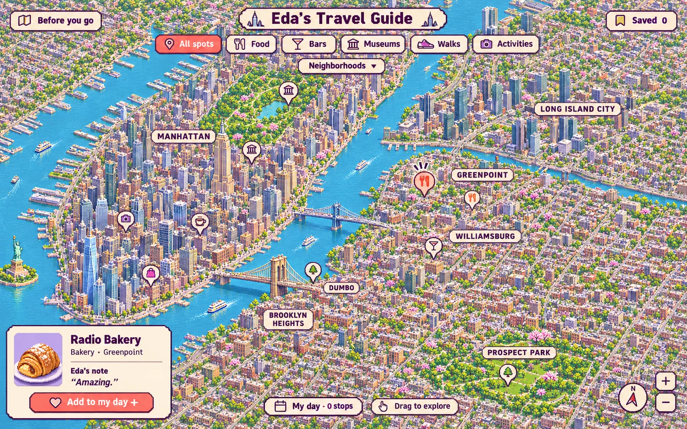

# Eda's New York

**Eda's Travel Guide** is a personal, interactive New York guide for friends visiting the city: Eda's recommendations, a playful miniature city map, easy café and food discovery, and saved places that are useful on a phone.

The working React/TypeScript app is in `src/`, alongside the original implementation handoff and visual references.

## Run locally

Use Node 20 or newer. Run `npm install`, then `npm run dev` for development. Run `npm test` for the 11 focused content/state tests and `npm run lint` for TypeScript checks. For the production preview run `npm run build`, then `npm run preview -- --host 127.0.0.1 --port 4173` and open http://127.0.0.1:4173. No account, token, or environment secrets are needed. The geographic basemap needs internet access; the list and device-local saves remain usable if the map fails.

To edit recommendations, update `docs/content/guide-seed.json`, keeping IDs and Eda's original notes stable. Verified branches live separately in `src/data/locations.json`; include address, geographic coordinates, branch label, source URLs and fact-check date. Areas and broad activities do not need invented point coordinates. Run `npm test` and preview the result after edits. Save data stays in this browser under `edas-new-york:saved:v1`.

## Start here

1. Read [AGENTS.md](AGENTS.md) and the [implementation brief](docs/START_HERE.md).
2. Inspect the [design references](docs/design/README.md), including the desktop Saved view and mobile detail view.
3. Follow the [product requirements](docs/PRODUCT.md), [design specification](docs/DESIGN.md), and [interaction specification](docs/INTERACTIONS.md).
4. Use the [architecture](docs/ARCHITECTURE.md) and [content/data contract](docs/CONTENT_AND_DATA.md).
5. Implement against the [acceptance checklist](docs/ACCEPTANCE.md).
6. See the [Factory Workstream kickoff](docs/FACTORY_WORKSTREAM.md) for the complete task and suggested work packages.

## Content and assets

- [Eda's original New York notes](docs/content/eda-original-notes.md): source of truth for her personal recommendations and opinions.
- [Structured seed content](docs/content/guide-seed.json): all 43 original guide entries, with stable IDs, categories, provenance, and explicit unknowns.
- [Visitor notes](docs/content/visitor-notes.md): publishable guidance and corrections to time-sensitive details.
- [Design tokens](docs/design/tokens.json): colors, dimensions, type roles, and motion values.
- [Sources and verification](docs/SOURCES.md): official technical/transit references and research requirements.
- [Source-built animation reference](docs/references/waldo/REUSE_GUIDE.md): exact reusable patterns from Waldo Stripes Soft, pinned source snapshots, adaptation notes and MIT attribution.

## What matters most

- The app opens into a beautiful, interactive geographic city map, with Manhattan, Brooklyn, Greenpoint, Williamsburg, and Long Island City in view.
- **Cafés & bakeries** and **Food** are obvious, one-tap filters.
- People can save from cards and place details, then open an equally obvious **Saved places** view.
- Bookmarks survive reload on the same browser without an account.
- The desktop and mobile experiences are both deliberately designed.
- The map is a real map with geographic coordinates, not a generated screenshot with percentage-positioned buttons.
- Eda's personality comes from her actual notes. Do not invent reviews, visits, ratings, opening hours, or recommendations.

## Visual hierarchy

The approved overview establishes the color and miniature-city direction. Written requirements take priority when a reference image differs: the final app must include a prominent café filter and a unified Saved collection. The earlier "My day" mockup control is not a separate required v1 feature.

Design images are references, not production map tiles or photographs of businesses. See [asset provenance](docs/design/README.md).

## Implementation target

Suggested stack: React, TypeScript, Vite, MapLibre GL JS, a customized map style, and browser-local bookmark storage. No AI model, login, database, or paid service is required for the core experience. Verify current dependency compatibility during implementation and commit the lockfile.

The completed app should document its install/dev/build/test commands here, plus how Eda can edit recommendations. Keep these handoff documents available after implementation.
