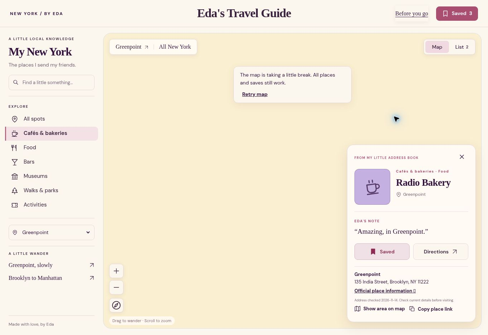
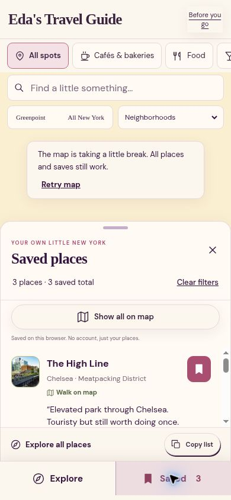

# Editorial guide layout

Latest direction, November 18, 2026: use the first editorial mockup, remove Find Eda, and retain the existing interactive geographic map. This supersedes earlier instructions to put all desktop filters above the map and retain the character hunt.

## Implementation

- Centered title in a 76 px cream header, with a quiet byline, Before you go, and Saved count.
- A 288 px address-book sidebar: introduction, search, category menu, neighborhood filter, two working shortcuts, and a simple footer. At smaller desktop widths it is 250 px.
- The existing MapLibre map is inset in a rounded frame. Its geographic data, miniature geometry, tile provider, fixed pitch/bearing, close opening zoom, and ambient ferry/steam/dog remain. The generated illustration is not shipped as a map background.
- Greenpoint / All New York and Map / List controls live inside the map frame. Category filters still preserve the camera. Layout-dependent camera padding now measures the map and panel rectangles, with limits to leave usable space for fitting locations. A ResizeObserver updates canvas dimensions without rebuilding the map.
- Results and Saved open on the right and collapse into a narrow rail. Closing or collapsing does not delete the collection. Search/category/neighborhood controls stay available in the sidebar.
- Selected-place cards sit at the lower right with a compact image/illustration beside the name, Eda's note, Save, directions, and the existing factual/branch information. Photo credits and not-visited badges are preserved.
- Greenpoint, slowly opens the existing Greenpoint collection; Brooklyn to Manhattan opens the existing Brooklyn Bridge walk. No invented itinerary or recommendation content was added.
- Find Eda's avatar, controls, persistence callbacks, reveal motion and celebration are no longer mounted. Existing saved-place data is not changed or migrated.
- At phone widths the sidebar becomes horizontal filters and search; the bottom Saved navigation and scrollable detail sheet remain.

No new dependency, paid service, account requirement, or API key. The creator-interest pilot is a separate PR and is not silently bundled into this design change.

## Verification performed

| Check | Result |
| --- | --- |
| TypeScript + production build | Passed. Existing MapLibre chunk-size warning remains. |
| Node test suite | All 30 tests passed. |
| Cafés + Greenpoint | Radio Bakery and Bakeri are shown; Food changes this to six results. |
| Collapse and change filter | Rail remains collapsed, count updates, and expanding restores the list. |
| Detail and directions | Correct Radio/Bakeri note and branch-specific Google Maps link remain available. |
| Save and reload | Saved Bakeri's Greenpoint branch; reload retained it alongside the two existing local QA bookmarks. |
| Remove and Undo | Count and bookmark restored; announcement confirmed restoration. |
| Keyboard preview | Tabbing through Radio's row opens the preview; Escape dismisses it without closing results. |
| Unvisited content | Lucali retains its explicit not-visited badge and original note. |
| Narrow layouts | Same-origin local QA frames at 390×844, 360×800 and 768×1024 had no horizontal document overflow. Café filtering and opening Radio worked at 360; Saved list opened at 390. This is viewport QA, not a physical-device test. |
| Desktop screenshot | Actual browser at 1363×936, with the new sidebar and compact Radio card. |
| Real 3D rendering, map-pin clicks, frame rate, camera composition | Not verified: this cloud browser cannot initialize the existing WebGL2 map. The application's real map-failure state is deliberately visible in screenshots. |
| Legacy full-map browser scripts | Updated the illustrated-map script to assert removal of the character hunt. Not run here; they need a WebGL-capable browser. |

## Browser evidence from the initial layout

These images predate the November 18 typography/content follow-up below.

These are real interface screenshots, not generated mockups. The blank map and error message show the QA browser's WebGL limitation.

## Review before merging

Use the branch preview in a WebGL2-capable browser. Confirm the inset map renders, a selected place stays left of the right-hand detail card, and pan/zoom plus Greenpoint/All New York still work. Try Walks & parks from a close view; it should change the results without zooming out. Open a walk, use Saved → Show all on map, and check pins/attribution remain clear of the new panels. The map model and data files are unchanged, but its viewport and camera padding have changed and need that visual check.

## November 18 typography and Greenpoint follow-up

- Self-hosted Fraunces 600 headings, 400 body-serif text, and 400 italic “My New York”; Hanken Grotesk for interface and body copy. Existing map model/camera remain unchanged.
- Sidebar now says “A LITTLE TRANSPLANT KNOWLEDGE”.
- Added a small cream-and-raspberry NYC skyline SVG favicon.
- Six new Greenpoint places; updated Ramirez and Rule of Thirds notes without duplicating existing entries. Shopping filter and shopping-bag icon added for Woods Grove. See content/greenpoint-november-update.md for provenance.
- Production build, all 31 Node tests, and CSV synchronization check pass. The existing MapLibre chunk-size warning remains.
- Updated visual QA is blocked: the cloud browser refused the local preview reload under its URL security policy. No updated screenshot or font/map visual pass is claimed. Earlier screenshots document only the prior layout. Check the Vercel preview before merging.

## Watercolor map treatment

The actual MapLibre map now uses warm paper land, muted blue water and sage parks, with softened coastline/park-edge pigment and desaturated rose/lavender building colors. Existing 3D extrusion heights, camera, geographic sources, markers, search and Saved are retained.

`src/map-art/watercolor.ts` generates three deterministic 256px repeating pigment textures locally and adds four map-projected layers below roads, buildings and labels. Textures have matching opposite edges, are registered before layers on `style.load`, and are restored when a style/context reloads. No bitmap map replacement, additional tile provider, screen-wide blur, animation loop or paid service is introduced. Three raw RGBA textures total 768 KiB before GPU overhead.

Validation: production build and all 32 tests pass, including full style validation and seam/size checks for the textures. Existing MapLibre bundle-size warning remains. The previous WebGL2/local-preview restrictions prevent an updated rendering screenshot; this is implemented but not visually approved. Review close Greenpoint and All New York in the Vercel preview, confirm subtle texture/no repeat seams, sharp labels, and usable pins.
