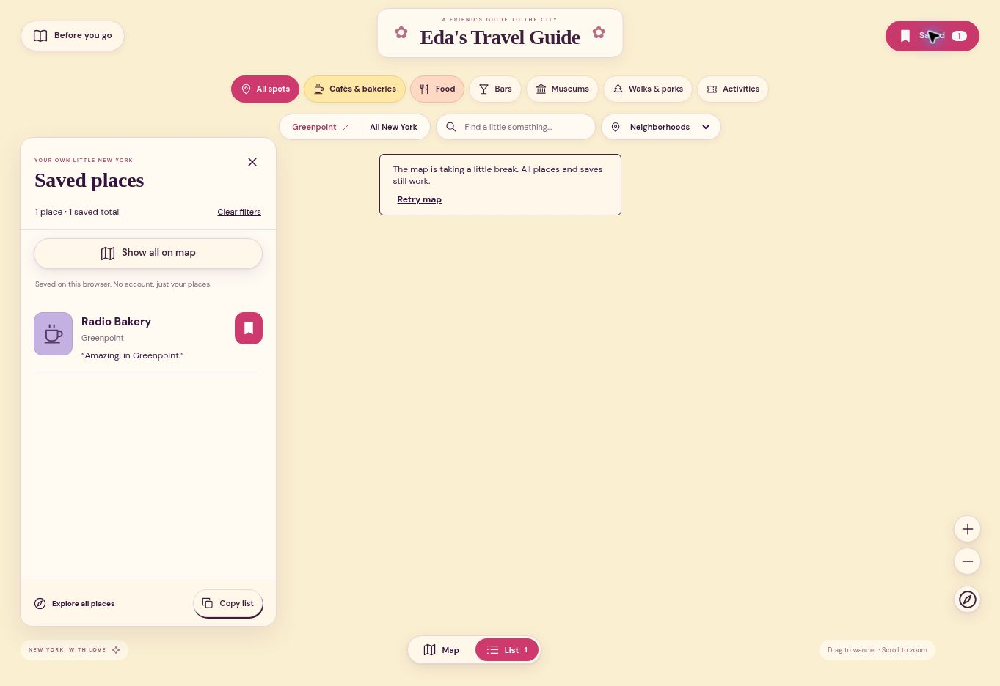
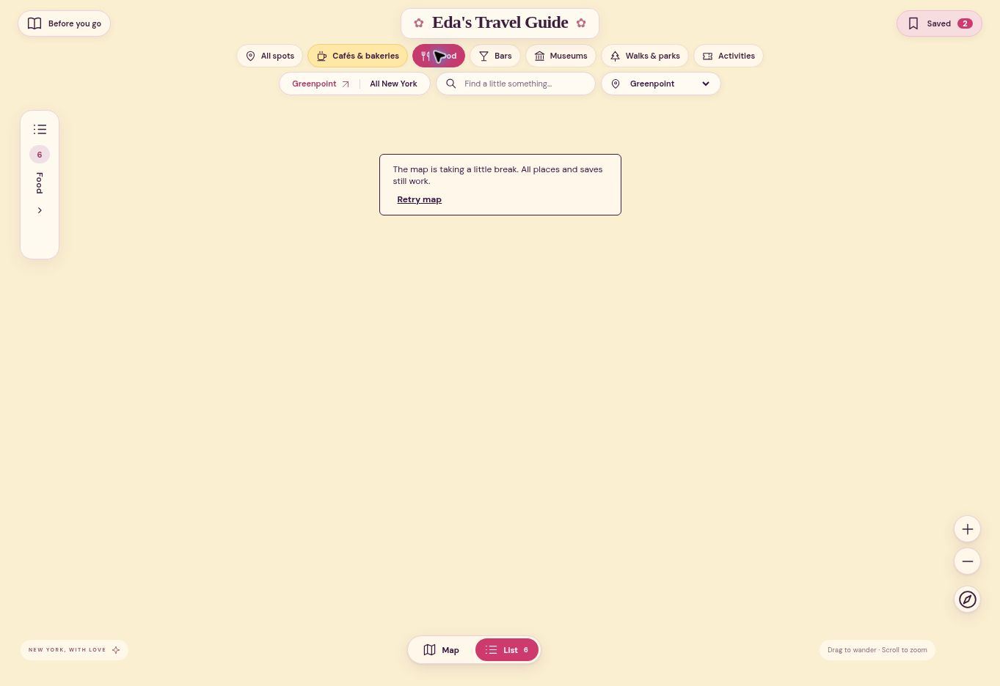
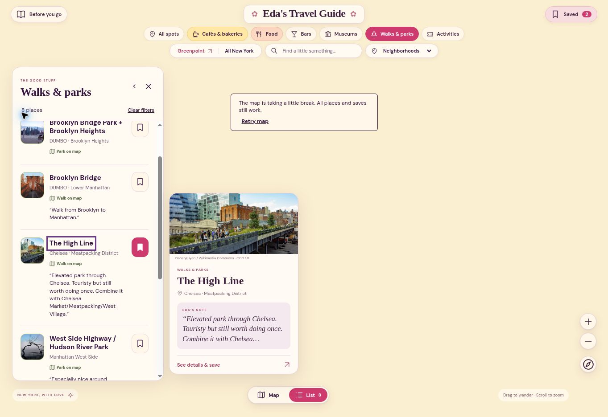

# Greenpoint desktop miniature

The map should feel like a neighborhood you can wander into, with readable café pins and a quiet interface around it. This change is a desktop pilot around Greenpoint. It replaces the distant opening view and flat building stickers with a closer, geographically grounded miniature.

## What changed

- Close opening camera: Greenpoint, zoom 17.35, pitch 55°, bearing 38°, narrow 26° field of view.
- Shared geographic 3D geometry for buildings, roof edges, windows, stoops, awnings, tables, planters and trees. No whole-building billboards.
- Compact centered title, category filters, search and neighborhood navigation. Separate Greenpoint / All New York actions.
- Smaller welcome note that disappears as browsing starts.
- Category filters preserve the current camera, including Walks & parks. They update pins and the list; selecting a specific place or an explicit navigation action moves the camera.
- Persistent place-name labels at neighborhood zoom, a visible raspberry Save action, compact detail and Saved panels.
- Existing recommendations, licensed photos, notes, directions, branch-specific saves and optional Find Eda game retained.
- No new paid service, runtime AI generation or backend.

## Checks actually performed

| Check | Result |
| --- | --- |
| Production build (`npm run build`) | Passed. Existing MapLibre chunk-size warning remains. |
| Type checking (`npm run lint`) | Passed. |
| Tests (`node --import tsx --test tests/*.test.ts`) | 30 passed, including map-style validation, bounded valid extrusion data, and existing content/storage/directions regressions. |
| Standard `npm test` launcher | The sandbox denies tsx's IPC pipe. The same test files passed using Node's tsx import hook above. |
| Browser: search Radio, open details, save | Passed. |
| Browser: refresh, open Saved | Radio Bakery remains saved and appears in the Saved collection. |
| Browser: Cafés & bakeries + Greenpoint | Radio Bakery and Bakeri shown; correct Greenpoint branch and source note retained. |
| Browser: direction target | Radio's existing encoded Google Maps destination is present. No external navigation was needed. |
| Browser: map rendering, camera composition, pin clicks, Find Eda, map motion | **Blocked:** this preview browser cannot initialize WebGL2. The app shows its existing recoverable map fallback. |
| Phone-size browser QA | Not completed; mobile redesign is outside this pass. |
| Deployment / merge | Not performed. Review this branch first. |

A separate geometry-only render was used during development to inspect the generated street layout. It is not an application screenshot and does not establish that MapLibre renders correctly.

## Browser evidence

The screenshot below verifies the Saved interface and explicitly shows the WebGL fallback. It is **not** a preview of the finished 3D map.



## Visual review still needed before merging

Run the branch locally in a WebGL2-capable browser:

```sh
npm install
npm run dev
```

At approximately 1440 × 900:

1. Open without a place URL. Confirm Greenpoint fills the viewport and Radio Bakery is easy to identify. Pan/zoom must stay usable, with no intro covering the center after interaction.
2. Compare the default zoom 17.35 with 17.05 and 17.65 in `MINIATURE_ZOOM` if fine-tuning framing. Keep pitch/bearing fixed. Prefer a few readable blocks over fitting every Greenpoint recommendation at once.
3. Check walls, roof caps, windows, storefronts and trees at opening zoom and one step closer. Inspect for flickering/coplanar faces, detached decorations, awkward geometry at the pilot boundary, and low frame rate. Correct these before approval if observed.
4. From a close view, choose Walks & parks: the camera must stay put while the list/pins update. Repeat after panning/zooming and from All New York. Selecting an individual park/walk should still focus that guide. Then choose Cafés & bakeries, search Radio, open the pin, Save, refresh and revisit Saved. Check that persistent labels do not cover neighboring clickable pins.
5. Try All New York, Long Island City, a Manhattan venue, a walk, and Saved → Show all on map. Return with Back to Greenpoint. Confirm geography and all camera actions retain the intended tilt.
6. Complete Find Eda and refresh. Verify that game completion and Saved remain separate. Confirm reduced motion stops the ferry/steam/dog and removes camera transitions.
7. Check a phone-sized window for overflow and usable Save/details, without expanding this into a mobile redesign.
8. Capture actual opening, café-selection and saved-place map screenshots before marking visual QA complete.

The existing browser regression scripts were adjusted for the close default and renamed map controls, but were not run here because the WebGL requirement is unmet. This is why the PR remains a draft.

## Geometry and cost notes

`public/data/greenpoint-miniature.geojson` is a checked-in OSM-derived geographic data asset, not a picture with hotspots. Rebuild it with `node scripts/build-greenpoint-miniature.mjs`. Its source/date template, bounds, feature counts and license are recorded in `src/map-art/miniature-bounds.json`. The download is bounded and runs only during development. OSM-derived data is under [ODbL](https://www.openstreetmap.org/copyright).

Façades and storefronts are decorative. They do not depict or brand the actual businesses. Heights, street widths and park furniture are stylized. The live basemap still loads from the project's existing OpenFreeMap source; the miniature adds a static download of roughly 0.52 MB if served with gzip, 6.3 MB uncompressed. Browser performance has not been measured because rendering is blocked here.

## Compact controls and richer previews (follow-up)

- Desktop pins now have a 28 × 30 px visible body for both venue and park/walk markers. An invisible 7 px perimeter extends the pointer target; keyboard activation is unchanged. Mobile marker sizing is retained.
- The desktop header ends at approximately 130 CSS px in the checked 1363 × 936 browser, with the title still centered. The eyebrow is removed on desktop, and vertical gaps and controls are shorter. The list starts at 150 px.
- Results and Saved lists can collapse into a 54 px rail using the left-chevron button beside Close. The rail retains category/context and result count. Expand returns to the same list, filters and scroll position. Filtering while collapsed updates its count without reopening it or reframing the map.
- Hover or keyboard-focus a list item or an individual map marker for a photo-and-note preview. Click the preview to open the existing full details and Save controls. Previews use only existing guide content and sourced photographs, with illustration fallbacks, source credits, favorite flags and explicit not-visited status. Branch rows/markers pass their own location ID.
- Previews support Escape, remain available while the source or preview has keyboard focus, and stay inside the space between the header and bottom controls. Reduced motion disables their entrance animation. Collapse and previews are desktop-only; shrinking to phone width expands any hidden list.

Browser checks completed for this follow-up:

| Behavior | Result |
| --- | --- |
| Header and rail measurements | Header bottom 130 px; rail width 54 px. |
| Collapse/expand list | Walks & parks retained 8 results and restored scrollTop 129 → 129. Focus moves to the corresponding expand/collapse button. |
| Change filters while collapsed | Greenpoint retained; switching cafés to Food kept the list collapsed and updated its count to 6. |
| Keyboard photo preview | The High Line showed its sourced photo, credit, neighborhood and original Eda note. |
| Escape | Dismissed preview while keeping the list open. |
| Preview → details → Save | The High Line opened correctly, saved, and appeared alongside Radio Bakery in Saved. |
| Collapse/expand Saved | Restored both saved entries and the Saved context. |
| Unsourced-photo fallback | Bakeri showed an illustration and “Date cake and tahini cookies.” |
| Build and tests | Production build passed; all 30 tests passed. |
| Actual map marker appearance/hover | Still unverified because this browser lacks WebGL2. |

These screenshots document the working interface with the environment's map fallback visible:




