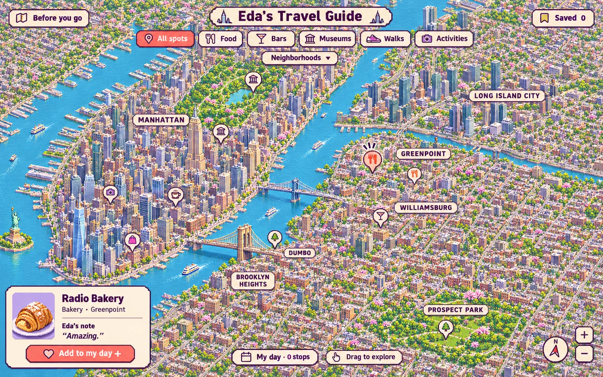
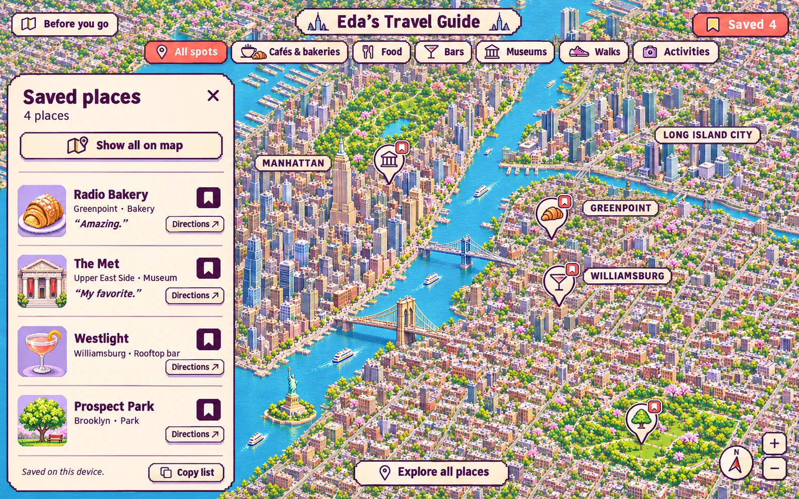
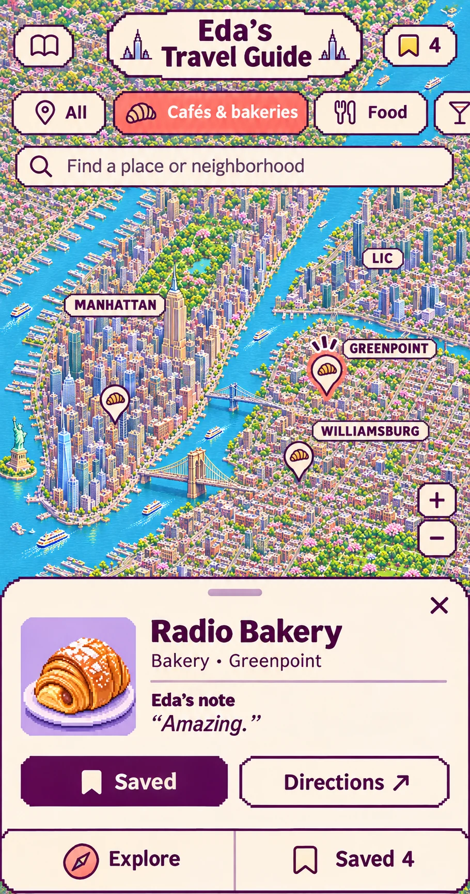
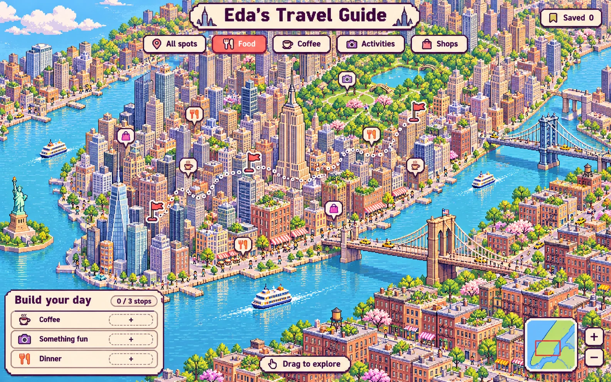
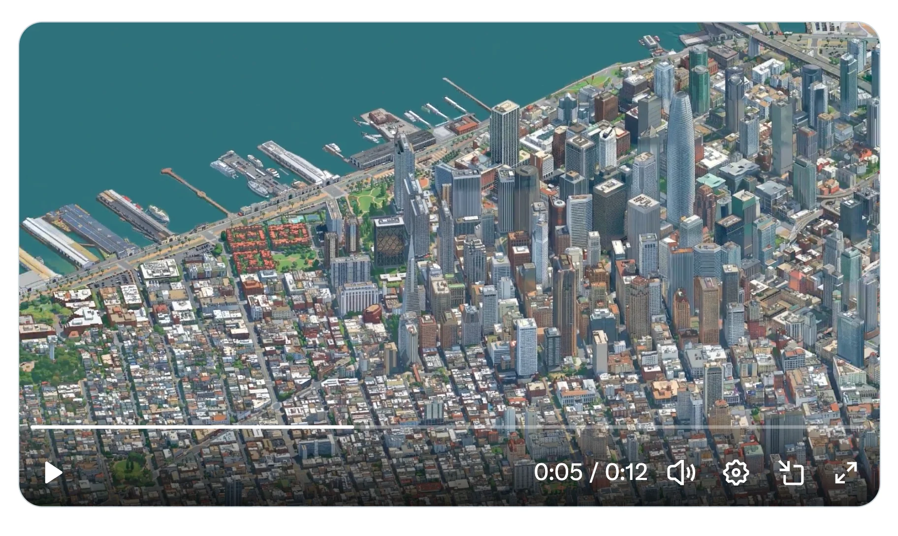

# Visual references

Open these images before implementing the UI. All paths are repository-relative below.

## 1. Approved city direction

`approved-city-overview.webp` is the latest overview the user liked. Preserve its blue/cream/plum/coral palette, miniature-city depth, broad Brooklyn/LIC coverage and floating game-like controls. The actual app needs true geographic data; image-generated buildings, bridges, landmarks and pins are not exact location references.

## 2. Desktop Saved view

`saved-places-desktop.webp` is a supporting mockup made for this implementation handoff. It makes the user's new priorities concrete: a visible Cafés & bakeries filter, obvious Saved count, readable saved rows, bookmark state and Show all on map. Counts/locations are illustrative UI state. Initialize a real new visitor with zero bookmarks.

## 3. Mobile café detail

`cafe-detail-mobile.webp` demonstrates a large reachable café filter, selected bakery pin, bottom detail sheet, saved action, directions and persistent Saved navigation. Implement these as responsive HTML controls, not a screenshot. Written contrast requirements override any insufficient contrast in generated chip artwork.

## 4. Original selected palette/game reference

`palette-and-game-ui-reference.webp` is the originally selected option 2. Its three-slot day planner and route line are not required v1 features. The latest requirement is a single flexible Saved collection. Preserve the palette and playful depth, not every old UI label.

## 5. Uploaded spatial reference

`aerial-city-spatial-reference.webp` is the user's uploaded screenshot. Use its elevated camera, miniature architectural geometry and street-level detail as visual reference. It depicts another city, and contains video-player controls; neither belongs in this NYC product. Original creator/license was not identified in the conversation. Keep this as an internal repository design reference; do not ship or present it as original production artwork.

## Provenance and production use

- Four concept/mockup images were generated in the conversation for Eda's project. The WebP files are packaging exports; originals were left intact.
- The aerial reference was supplied by the user.
- No image in this directory proves that the website exists or its controls work.
- Do not use these complete screenshots as a live map background or cut out an invented storefront and call it a business photo.
- Build actual UI, source-generated/owned icons and geographic map layers. For venue imagery use Eda's photos, licensed images, or clearly illustrative category art.
- The user also supplied a source-built 3D scene repository. Its code reuse is covered in `../references/waldo/REUSE_GUIDE.md` and its MIT notice.

## Design prompt summaries

The generated concepts were created using the built-in image tool. Main visual brief: whimsical miniature 3D/isometric New York, wide Manhattan/Brooklyn/LIC coverage, cream pixel-edged panels, plum text/outlines, blue water, coral selections, green parks and lavender shadows; centered Eda's Travel Guide title; category filters and readable place cards. The desktop Saved variant adds four saved entries and a collection drawer. The mobile variant adds the café filter, Radio Bakery sheet and persistent Explore/Saved tabs.

Authoritative interaction details, exact tokens and text behavior are in `../DESIGN.md`, `tokens.json`, and `../INTERACTIONS.md`.
